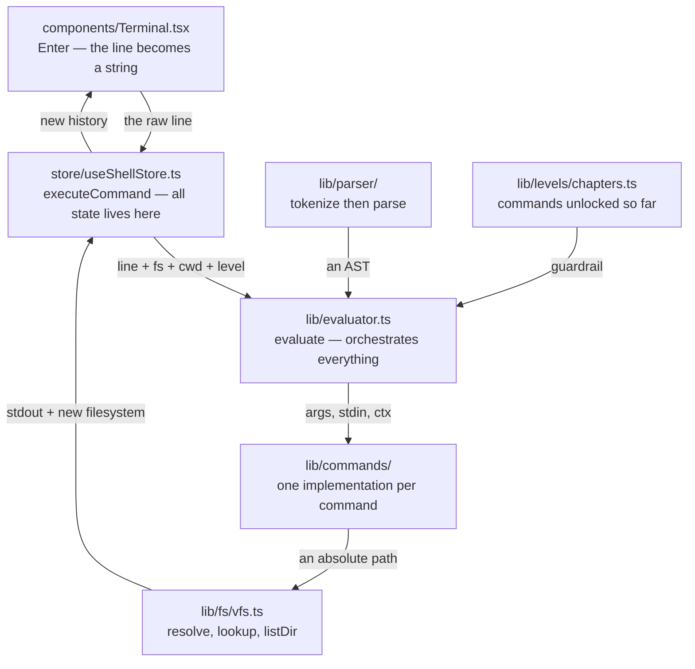
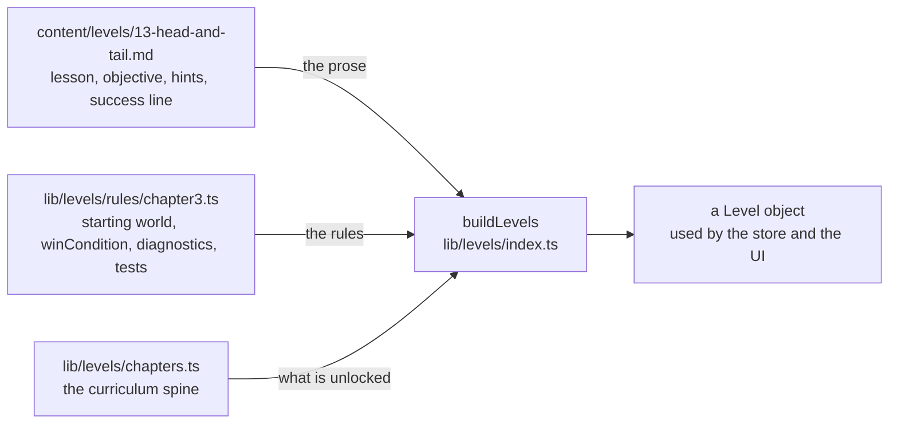
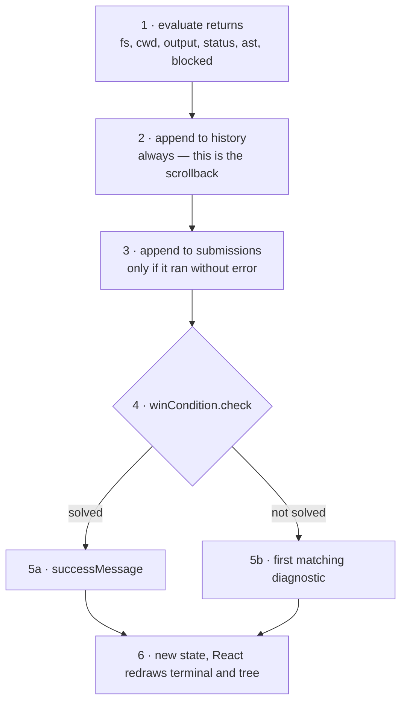

# Architecture

How a typed line travels through the codebase, and which file owns which job.

Every box below is a real path in this repo.

## The round trip

Shelly is a loop: you type, the engine runs, the screen redraws, you type again.
A line descends through five files and comes back.



`lib/parser/` and `chapters.ts` sit to the side because they are not steps in the
descent — the evaluator *calls* them and gets an answer back before carrying on.
If the guardrail rejects the command, the line stops there and nothing below runs.

There are two distinct layers in the middle, and mixing them up is the usual
source of confusion:

- **Understanding the line** — `lib/parser/`. Splits words from operators and
  works out what belongs to what. It does not open a file, and it has no idea
  what `ls` means.
- **Doing the work** — `lib/commands/` and `lib/fs/vfs.ts`. Here the command
  actually runs and the filesystem changes.

## What each directory owns

Each layer only knows the one below it. The parser does not know what a file is,
and the VFS does not know a game exists.

| Path | Owns | Size |
| --- | --- | --- |
| `components/` | The TUI — terminal, lesson pane, ASCII tree, chapter map. Reads state and draws. Decides nothing. | 11 components |
| `store/useShellStore.ts` | The kernel: filesystem, working directory, history, progress, help ladder. The only place state changes. | 398 lines |
| `lib/evaluator.ts` | Guardrails, pipelines, redirection, and who receives which input. | 256 lines |
| `lib/parser/` | Text into structure: quotes, escapes, `\|`, `>`, `&&`. | 239 lines |
| `lib/commands/` | One file per family. Every command has the same shape, which is why pipes work for free. | 21 commands |
| `lib/fs/vfs.ts` | The virtual filesystem: path resolution, reads, writes, moves, and the ASCII tree. | 254 lines |

Commands share one signature, and that is the whole reason a pipeline needs no
special cases:

```ts
type CommandImpl = (args: string[], stdin: string, ctx: ExecContext) => CommandResult;
```

Each submission runs against a **clone** of the filesystem, so a line that fails
halfway cannot leave the tree half-mutated, and React always receives a new
object to render.

## A level has two halves

No single file holds "a level". The **prose** lives in markdown and the **logic**
lives in TypeScript — markdown is the right medium for a lesson, TypeScript is
the right medium for a win condition. They meet in the browser.



The markdown is read on the server by `lib/levels/loadContent.ts` and handed to
the client as props; the rules are imported directly into the browser bundle.

`allowedCommands` is **derived, never authored**: a level allows everything its
own chapter and every earlier chapter unlocks. The sandbox remembers what you
have learned, instead of carrying a hand-maintained whitelist per level.

## After a command runs

The least obvious part, and where a real bug lived. When the evaluator returns,
the store does five things in order, and the order matters.



Step 3 is the fix for a bug worth remembering. Submissions used to be recorded
for any line that parsed and was not blocked — so an `ls -a` that **failed**
still counted as "you used the `-a` flag", and level 2 could be finished without
ever seeing a hidden file. A command that errored showed the player nothing, so
it cannot stand in for having done the thing.

### Levels that change nothing

A level about `cd` or `ls` leaves the filesystem exactly as it found it, so there
is no state to assert on. Those win conditions read `submissions` instead — every
accepted line this level, parsed, with the directory it ran from:

```ts
check: ({ cwd, submissions }) =>
  cwd === NOTES && ran(submissions, "ls", { operandPaths: [SRC] }),
```

`ran` (in `lib/levels/assert.ts`) works on the AST, never on raw text, so
`ls -la`, `ls -a -l` and `ls -al` are one assertion — and `ls ../projects/web/src`,
`ls ~/projects/web/src` and the absolute path all resolve to the same answer.

## Where to change what

| You want to | File |
| --- | --- |
| Rewrite a lesson | `content/levels/NN-name.md` |
| Change what counts as winning, or a near-miss message | `lib/levels/rules/chapterN.ts` |
| Add a command | `lib/commands/`, plus a page in `lib/tldr.ts` |
| Unlock a command in a different chapter | `lib/levels/chapters.ts`, the `unlocks` field |
| Teach the shell new syntax (globbing, variables, `if`) | `lib/parser/` — the heavy lift of Phase 4 |
| Change a chapter's starting filesystem | `lib/levels/worlds.ts` |
| Change the look | `components/*.module.css`, `app/globals.css` |

## Testing

203 tests cover everything above `components/`. `tests/levels.test.ts` iterates
the whole catalog and asserts, for every level: each canonical solution solves
it, no near miss solves it, every near miss gets either a diagnostic or a shell
error, the prose is authored, and every unlocked command is implemented and
documented.

That contract is what makes the catalog safe to grow — see
[ROADMAP.md](ROADMAP.md) for where it is going.
